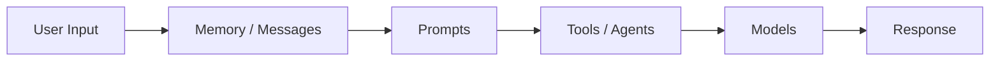

# 🦜🔗 LangChain Cheatsheet (Python)

> Resumen de comandos y funcionalidades del curso **LangChain for Beginners**
> (capítulos 01 a 09). Pensado para consulta rápida: copia, pega y adapta.

---

## 📑 Índice

1. [Setup y variables de entorno](#1--setup-y-variables-de-entorno)
2. [Primera llamada a un LLM](#2--primera-llamada-a-un-llm)
3. [Mensajes](#3--mensajes)
4. [Chat models: conversación, streaming, parámetros](#4--chat-models-conversación-streaming-parámetros)
5. [Inicialización agnóstica al proveedor](#5--inicialización-agnóstica-al-proveedor-init_chat_model)
6. [Errores, reintentos y tokens](#6--errores-reintentos-y-tokens)
7. [Prompt templates](#7--prompt-templates)
8. [Structured outputs con Pydantic](#8--structured-outputs-con-pydantic)
9. [Tools y function calling](#9--tools-y-function-calling)
10. [Agentes (`create_agent`)](#10--agentes-create_agent)
11. [Middleware](#11--middleware)
12. [MCP (Model Context Protocol)](#12--mcp-model-context-protocol)
13. [Documentos, splitters y metadata](#13--documentos-splitters-y-metadata)
14. [Embeddings y vector stores](#14--embeddings-y-vector-stores)
15. [RAG: tradicional vs agéntico](#15--rag-tradicional-vs-agéntico)
16. [Deploy en Microsoft Foundry](#16--deploy-en-microsoft-foundry-con-azd)
17. [Troubleshooting rápido](#17--troubleshooting-rápido)
18. [Mapa mental del curso](#18--mapa-mental-del-curso)

---

## 1. 🔧 Setup y variables de entorno

### Instalación

```bash
# Núcleo + OpenAI + dotenv
pip install langchain langchain-openai python-dotenv

# Core / splitters / community (documentos y RAG)
pip install langchain-core langchain-text-splitters langchain-community

# Proveedor-agnóstico con Azure AI / GitHub Models
pip install langchain-azure-ai

# MCP
pip install langchain-mcp-adapters mcp

# Agentic RAG (según el capítulo 8)
pip install langchain langchain-openai langchain-core langgraph python-dotenv
```

### Archivo `.env`

```bash
AI_MODEL=gpt-5-mini                      # nombre del modelo / deployment
AI_ENDPOINT=https://models.inference.ai.azure.com   # endpoint del proveedor
AI_API_KEY=tu-api-key                    # credencial
AI_EMBEDDING_MODEL=text-embedding-ada-002 # solo para embeddings
```

### Cargar variables en Python

```python
from dotenv import load_dotenv
import os

load_dotenv()
os.getenv("AI_MODEL")
```

> 💡 Cambiar de proveedor (GitHub Models, Microsoft Foundry, OpenAI…) = cambiar el `.env`, **no el código**.

---

## 2. 🚀 Primera llamada a un LLM

```python
from langchain_openai import ChatOpenAI
from dotenv import load_dotenv
import os

load_dotenv()

model = ChatOpenAI(
    model=os.getenv("AI_MODEL"),
    base_url=os.getenv("AI_ENDPOINT"),
    api_key=os.getenv("AI_API_KEY"),
)

response = model.invoke("What is LangChain in one sentence?")
print(response.content)
```

| Elemento | Qué hace |
|---|---|
| `ChatOpenAI(...)` | Crea el modelo de chat |
| `.invoke(...)` | Llamada estándar (espera la respuesta completa) |
| `response.content` | Texto de la respuesta |

**Los 5 conceptos base de LangChain:** Models · Prompts · Tools · Agents · Memory.

---

## 3. 💬 Mensajes

```python
from langchain_core.messages import SystemMessage, HumanMessage, AIMessage, ToolMessage
```

| Clase | Propósito |
|---|---|
| `SystemMessage` | Define comportamiento / personalidad de la IA |
| `HumanMessage` | Entrada del usuario |
| `AIMessage` | Respuesta de la IA (`content`, `usage_metadata`, `id`, `tool_calls`) |
| `ToolMessage` | Resultado de ejecutar una tool (lleva `tool_call_id`) |

```python
messages = [
    SystemMessage(content="You are a helpful assistant"),
    HumanMessage(content="Hello!"),
]
response = model.invoke(messages)
```

Otras formas válidas (formato diccionario / tupla):

```python
{"role": "system", "content": "..."}
("human", "Hola")          # usado por agentes: {"messages": [("human", query)]}
```

### Comparar modelos

```python
for name in ["gpt-5", "gpt-5-mini"]:
    m = ChatOpenAI(model=name, base_url=os.getenv("AI_ENDPOINT"), api_key=os.getenv("AI_API_KEY"))
    print(name, m.invoke("Explain recursion in one sentence.").content)
```

---

## 4. 🗣️ Chat models: conversación, streaming, parámetros

### Conversación multi-turno

El modelo **no recuerda nada**: tú reenvías todo el historial en cada `invoke()`.

```python
messages = [
    SystemMessage(content="You are a helpful coding tutor"),
    HumanMessage(content="What is Python?"),
]

r1 = model.invoke(messages)
messages.append(AIMessage(content=r1.content))          # guardar respuesta

messages.append(HumanMessage(content="Show me an example"))
r2 = model.invoke(messages)                             # ya tiene contexto
```

### Streaming

```python
for chunk in model.stream("Explain how the internet works"):
    print(chunk.content, end="", flush=True)
```

| ✅ Úsalo para | ❌ Evítalo si |
|---|---|
| Respuestas largas, chatbots, UX interactiva | Necesitas la respuesta completa antes (parsing, validación) |

### Parámetros del modelo

```python
model = ChatOpenAI(
    model=os.getenv("AI_MODEL"),
    base_url=os.getenv("AI_ENDPOINT"),
    api_key=os.getenv("AI_API_KEY"),
    temperature=0,      # aleatoriedad
    max_tokens=1000,    # tope de longitud de respuesta
)
```

| `temperature` | Comportamiento | Usar para |
|---|---|---|
| `0` | Determinista | Código, respuestas factuales |
| `~1` | Equilibrado (por defecto) | Conversación general |
| `~2` | Muy creativo | Escritura creativa, brainstorming |

> ⚠️ Rango según proveedor: GitHub Models 0–2; Microsoft Foundry normalmente 0–1; algunos modelos **solo aceptan el valor por defecto (1)** y devuelven error 400 con otros.

**Tokens:** 1 token ≈ 4 caracteres ≈ ¾ de palabra. `max_tokens=100` ≈ 75 palabras.

---

## 5. 🔌 Inicialización agnóstica al proveedor (`init_chat_model`)

```python
from langchain.chat_models import init_chat_model
import os

os.environ["AZURE_AI_ENDPOINT"] = os.getenv("AI_ENDPOINT")
os.environ["AZURE_AI_CREDENTIAL"] = os.getenv("AI_API_KEY")

model = init_chat_model("azure_ai:gpt-5-mini")
response = model.invoke("What is LangChain?")
```

| Proveedor | Formato del string |
|---|---|
| Azure AI | `azure_ai:<modelo>` |
| OpenAI | `openai:<modelo>` |
| Anthropic | `anthropic:<modelo>` |
| Google | `google-genai:<modelo>` |

**Endpoints para `langchain-azure-ai`:**

| Proveedor | Endpoint |
|---|---|
| GitHub Models | `https://models.inference.ai.azure.com` (tal cual) |
| Microsoft Foundry | `https://<recurso>.openai.azure.com/models` (usar `/models`, **no** `/openai/v1`) |

---

## 6. 🛡️ Errores, reintentos y tokens

### Errores comunes

| Código | Significado |
|---|---|
| `429` | Rate limit excedido |
| `401` | API key inválida |
| `500` | Error temporal del proveedor |
| timeout | Problemas de red |

### Reintentos automáticos (backoff exponencial)

```python
model_with_retry = model.with_retry(stop_after_attempt=3)

try:
    response = model_with_retry.invoke("What is LangChain?")
except Exception as error:
    if "429" in str(error):
        print("Rate limit. Espera un poco.")
    elif "401" in str(error):
        print("Revisa tu API key en .env")
```

> ⚠️ **Limitación conocida:** `with_retry()` funciona con `.invoke()` pero puede **no** funcionar con `.stream()`.

### Tracking de tokens

```python
response = model.invoke("Explain what Python is in 2 sentences.")
usage = response.usage_metadata

usage.get("input_tokens")    # prompt
usage.get("output_tokens")   # respuesta
usage.get("total_tokens")    # total (base del coste)
```

### Optimizar costes

```python
# 1) Limitar la longitud de salida
model = ChatOpenAI(..., max_tokens=1000)

# 2) Recortar historial
recent = messages[-10:]
model.invoke(recent)
```

---

## 7. 📝 Prompt templates

### Mensajes vs Templates

| | Mensajes | Templates |
|---|---|---|
| **Ideal para** | Agentes, flujos dinámicos | RAG, prompts reutilizables |
| **Flexibilidad** | Alta | Media |
| **Reutilización** | Baja | Alta |

### `ChatPromptTemplate` + chain con `|`

```python
from langchain_core.prompts import ChatPromptTemplate

template = ChatPromptTemplate.from_messages([
    ("system", "You are a helpful assistant that translates {input_language} to {output_language}."),
    ("human", "{text}"),
])

chain = template | model            # operador pipe = chain

result = chain.invoke({
    "input_language": "English",
    "output_language": "Spanish",
    "text": "Hello, how are you?",
})
print(result.content)
```

### `PromptTemplate` (prompt simple, sin roles)

```python
from langchain_core.prompts import PromptTemplate

simple = PromptTemplate.from_template("Answer this {topic} question briefly: {question}")
(simple | model).invoke({"topic": "science", "question": "Why is the sky blue?"})
```

| Tipo | Uso | Sintaxis |
|---|---|---|
| `ChatPromptTemplate` | Conversaciones con roles | `from_messages([("role", "content")])` |
| `PromptTemplate` | Prompt simple de una pieza | `from_template("texto {var}")` |

### Few-shot (enseñar con ejemplos)

**Con mensajes:**

```python
messages = [SystemMessage(content="You are an emoji translator.")]
for ex in examples:
    messages.append(HumanMessage(content=ex["question"]))
    messages.append(AIMessage(content=ex["answer"]))
messages.append(HumanMessage(content="surprised"))
```

**Con templates:**

```python
from langchain_core.prompts import ChatPromptTemplate, FewShotChatMessagePromptTemplate

examples = [
    {"input": "happy", "output": "😊"},
    {"input": "sad", "output": "😢"},
]

example_template = ChatPromptTemplate.from_messages([
    ("human", "{input}"),
    ("ai", "{output}"),
])

few_shot = FewShotChatMessagePromptTemplate(
    example_prompt=example_template,
    examples=examples,
)

final = ChatPromptTemplate.from_messages([
    ("system", "You are an emoji translator."),
    few_shot,
    ("human", "{input}"),
])

(final | model).invoke({"input": "angry"})
```

### Composición de templates

```python
base = """You are a {role} assistant.
Your communication style is {style}."""

educator = ChatPromptTemplate.from_messages([
    ("system", base),
    ("system", "Focus on teaching concepts clearly with examples."),
    ("human", "{question}"),
])
```

---

## 8. 🧱 Structured outputs con Pydantic

```python
from pydantic import BaseModel, Field
from typing import Literal

class Person(BaseModel):
    """Schema for person information."""
    name: str = Field(description="The person's full name")
    age: int = Field(description="The person's age in years")
    occupation: str = Field(description="The person's job")

structured_model = model.with_structured_output(Person)

result = structured_model.invoke("Extract info from: John Smith is a 35-year-old engineer.")
print(result.name, result.age, result.occupation)   # objeto tipado
```

### Esquemas anidados y enums

```python
class Address(BaseModel):
    street: str = Field(description="Street address")
    city: str = Field(description="City")
    country: str = Field(description="Country")

class Company(BaseModel):
    name: str = Field(description="Company name")
    industry: Literal["Technology", "Finance", "Healthcare", "Retail", "Other"] = Field(
        description="Industry sector"
    )
    employee_count: int = Field(description="Number of employees")
    headquarters: Address = Field(description="HQ location")   # anidado
    is_public: bool = Field(description="Publicly traded?")

result = model.with_structured_output(Company).invoke("Extract company info from: ...")
print(result.headquarters.city)       # acceso con punto
```

**Claves:** `BaseModel` define el esquema · `Field(description=...)` guía a la IA · `Literal[...]` restringe valores · Pydantic valida los tipos.

---

## 9. 🛠️ Tools y function calling

> **Idea central:** el LLM **nunca ejecuta** funciones. Solo *describe* qué función llamar y con qué argumentos. **Tu código** la ejecuta.

### Crear una tool con `@tool` + schema Pydantic

```python
from langchain_core.tools import tool
from pydantic import BaseModel, Field

class CalculatorInput(BaseModel):
    expression: str = Field(description="The mathematical expression, e.g. '25 * 4'")

@tool(args_schema=CalculatorInput)
def calculator(expression: str) -> str:
    """Useful for performing mathematical calculations."""   # ← el LLM lee esto
    try:
        allowed = {"abs": abs, "round": round, "min": min, "max": max}
        return f"The result is: {eval(expression, {'__builtins__': {}}, allowed)}"
    except Exception as e:
        return f"Error evaluating expression: {e}"

calculator.name          # "calculator"
calculator.description   # docstring
calculator.invoke({"expression": "25 * 4"})   # probar la tool directamente
```

Versión corta (sin schema explícito, usando docstring con `Args`):

```python
@tool
def get_weather(city: str) -> str:
    """Get the current weather for a city.

    Args:
        city: The city name
    """
    return f"Weather in {city}: 72°F"
```

> 🔒 `eval()` es solo para el curso. En producción usa `simpleeval` / `mathjs` o similar.

### Componentes de una tool

| Componente | Función |
|---|---|
| Nombre | Cómo la referencia el LLM |
| Descripción (docstring) | Ayuda al LLM a decidir cuándo usarla |
| Schema (Pydantic) | Define los parámetros |
| Implementación | Lo que hace realmente |

### `bind_tools()` → el modelo conoce las tools

```python
model_with_tools = model.bind_tools([calculator])      # una
model_with_tools = model.bind_tools([calculator, search, get_weather])   # varias

response = model_with_tools.invoke("What is 25 * 17?")
response.tool_calls
# [{"name": "calculator", "args": {"expression": "25 * 17"}, "id": "..."}]
```

### Ciclo completo manual (generar → ejecutar → responder)

```python
from langchain_core.messages import HumanMessage, AIMessage, ToolMessage

query = "What's the weather in Seattle?"

# 1) LLM planifica (genera tool_call)
response1 = model_with_tools.invoke(query)
tool_call = response1.tool_calls[0]

# 2) TU código ejecuta la tool
tool_result = get_weather.invoke(tool_call["args"])

# 3) Devolver resultado al LLM
messages = [
    HumanMessage(content=query),
    AIMessage(content="", tool_calls=response1.tool_calls),
    ToolMessage(content=tool_result, tool_call_id=tool_call["id"]),
]
final = model.invoke(messages)
print(final.content)
```

### Buenas prácticas

```python
# ✅ Descripciones claras y específicas
"Get current weather for a specific city. Returns temperature, conditions and humidity."

# ✅ Parámetros descriptivos
class WeatherInput(BaseModel):
    city: str = Field(description="City name, e.g. 'Paris'")
    units: Literal["celsius", "fahrenheit"] = Field(description="Temperature unit")

# ✅ Manejo de errores dentro de la tool
@tool
def safe_tool(param: str) -> str:
    """Does X with error handling."""
    try:
        return do_something(param)
    except Exception as error:
        return f"Error: {error}. Try different parameters."

# ✅ Validación
class EmailInput(BaseModel):
    email: str = Field(description="Valid email")
    subject: str = Field(min_length=1, description="Subject")
```

---

## 10. 🤖 Agentes (`create_agent`)

### Patrón ReAct

```
Thought → Action (tool) → Observation → (repetir) → Final Answer
```

### Agente básico

```python
from langchain.agents import create_agent
from langchain_core.messages import HumanMessage

agent = create_agent(
    model=os.getenv("AI_MODEL"),          # también puedes pasar una instancia ChatOpenAI(...)
    tools=[calculator],
    system_prompt="You are a helpful math assistant.",
)

response = agent.invoke({"messages": [HumanMessage(content="What is 125 * 8?")]})
print(response["messages"][-1].content)    # respuesta final = último mensaje
```

### Varios tools: el agente elige

```python
agent = create_agent(
    model=os.getenv("AI_MODEL"),
    tools=[calculator, get_weather, search],
    system_prompt="You are a helpful assistant with access to multiple tools.",
)
```

### Formas de invocar

```python
agent.invoke({"messages": [HumanMessage(content=query)]})   # síncrono
agent.invoke({"messages": [("human", query)]})              # con tupla
await agent.ainvoke({"messages": [("human", query)]})       # asíncrono (MCP)
```

### Bucle ReAct manual (para entender qué hace `create_agent`)

```python
def run_react_loop(query, tools, max_iterations=5):
    tools_by_name = {t.name: t for t in tools}
    model_with_tools = model.bind_tools(tools)
    messages = [HumanMessage(content=query)]

    for _ in range(max_iterations):
        response = model_with_tools.invoke(messages)
        messages.append(response)

        if not response.tool_calls:          # sin tool calls = respuesta final
            return response.content

        for tc in response.tool_calls:
            result = tools_by_name[tc["name"]].invoke(tc["args"])
            messages.append(ToolMessage(content=str(result), tool_call_id=tc["id"]))

    return "Max iterations reached"
```

### Qué hace `create_agent()` por ti

- ✅ Gestiona el bucle ReAct
- ✅ Gestiona el historial de mensajes
- ✅ Límite de iteraciones (evita bucles infinitos)
- ✅ Manejo de errores listo para producción

### Cómo elige tool el agente

Por **nombre + descripción + schema** de la tool. Consejos: nombres descriptivos (`get_weather`, no `tool1`), descripciones claras, documentar parámetros con `Args:`, y que las tools devuelvan resultados **descriptivos**.

---

## 11. 🧩 Middleware

Middleware = "plugins" que interceptan al agente sin tocar tools ni lógica.

```python
from langchain.agents import create_agent
from langchain.agents.middleware import AgentMiddleware, ModelRequest
from langchain.agents.middleware.types import ModelResponse
from langchain_core.messages import ToolMessage
from typing import Callable, Any

# 1) Interceptar llamadas AL modelo
class DynamicModelMiddleware(AgentMiddleware):
    def __init__(self, messages_threshold: int = 10):
        super().__init__()
        self.messages_threshold = messages_threshold

    def wrap_model_call(self, request: ModelRequest,
                        handler: Callable[[ModelRequest], ModelResponse]) -> ModelResponse:
        if len(request.state["messages"]) > self.messages_threshold:
            return handler(request.override(model=advanced_model))   # cambia de modelo
        return handler(request)

# 2) Interceptar ejecución de tools
class ToolErrorMiddleware(AgentMiddleware):
    def wrap_tool_call(self, request: Any,
                       handler: Callable[[Any], ToolMessage]) -> ToolMessage:
        try:
            return handler(request)
        except Exception as e:
            return ToolMessage(
                content=f"I encountered an error: {e}. Let me try a different approach.",
                tool_call_id=request.tool_call.get("id", ""),
            )

agent = create_agent(
    model,
    tools=[calculator, search],
    middleware=[DynamicModelMiddleware(), ToolErrorMiddleware()],
)
```

| Hook              | Intercepta         | Casos de uso                                                 |
| ----------------- | ------------------ | ------------------------------------------------------------ |
| `wrap_model_call` | Llamadas al modelo | Selección dinámica de modelo, logging, inyección de contexto |
| `wrap_tool_call`  | Ejecución de tools | Reintentos, errores, transformar resultados, permisos        |

---

## 12. 🌐 MCP (Model Context Protocol)

Estándar abierto ("USB-C para IA"): los servicios exponen tools por un protocolo común; tu agente se conecta y las usa con el mismo `create_agent()`.

```bash
pip install langchain-mcp-adapters mcp
```

### Transportes

| Transporte | Cómo se comunica | Cuándo usarlo |
|---|---|---|
| `streamable_http` | Red (URL) | Servidor accesible por URL (local o remoto) |
| `stdio` | Subproceso (stdin/stdout) | Servidor que corre como proceso hijo de tu app |

### Servidor remoto (HTTP) — ejemplo Context7

```python
import asyncio
from langchain.agents import create_agent
from langchain_mcp_adapters.client import MultiServerMCPClient

async def main():
    client = MultiServerMCPClient({
        "context7": {
            "transport": "streamable_http",
            "url": "https://mcp.context7.com/mcp",
        }
    })

    tools = await client.get_tools()              # descubre las tools del servidor
    agent = create_agent(model, tools)            # mismo patrón de siempre

    response = await agent.ainvoke({"messages": [("human", "How do I use requests.get?")]})
    print(response["messages"][-1].content)

asyncio.run(main())
```

Tools de Context7: `resolve-library-id` y `get-library-docs`.

### Servidor local (stdio)

```python
from pathlib import Path

client = MultiServerMCPClient({
    "localCalculator": {
        "transport": "stdio",
        "command": "python",
        "args": [str(Path(__file__).parent / "servers" / "stdio_calculator_server.py")],
    }
})
```

### Varios servidores a la vez

```python
client = MultiServerMCPClient({
    "context7":   {"transport": "streamable_http", "url": "https://mcp.context7.com/mcp"},
    "calculator": {"transport": "stdio", "command": "python", "args": [str(server_path)]},
})
tools = await client.get_tools()     # combina tools de todos los servidores
```

### Autenticación con headers

```python
"context7": {
    "transport": "streamable_http",
    "url": "https://mcp.context7.com/mcp",
    "headers": {"Authorization": f"Bearer {os.getenv('CONTEXT7_API_KEY')}"},
}
```

### Producción: timeout + retry

```python
import asyncio

tools = await asyncio.wait_for(client.get_tools(), timeout=10.0)

response = await asyncio.wait_for(
    agent.ainvoke({"messages": [("human", query)]}),
    timeout=30,
)
# + model.with_retry(), fallbacks, health checks, cerrar conexiones en finally
```

### Crear tu propio servidor MCP

```python
from mcp.server.fastmcp import FastMCP

mcp = FastMCP("my-calculator")

@mcp.tool()
def calculate(expression: str) -> str:
    """Perform mathematical calculations.

    Args:
        expression: Math expression, e.g. '2 + 2'
    """
    return str(eval(expression, {"__builtins__": {}}, safe_namespace))

mcp.run(transport="streamable-http", port=3000)    # → http://localhost:3000/mcp
```

Conectarse a él:

```python
MultiServerMCPClient({
    "myCalculator": {"transport": "streamable_http", "url": "http://localhost:3000/mcp"}
})
```

Context7 local (opcional): `npx -y @upstash/context7-mcp --transport http --port 3000` y `MCP_SERVER_URL=http://localhost:3000/mcp` en `.env`.

---

## 13. 📄 Documentos, splitters y metadata

### Cargar documentos

```python
from langchain_community.document_loaders import TextLoader

loader = TextLoader("./data/sample.txt")
docs = loader.load()                  # lista de Document

docs[0].page_content                  # texto
docs[0].metadata                      # {"source": "./data/sample.txt"}
```

### Crear `Document` manualmente

```python
from langchain_core.documents import Document

doc = Document(
    page_content="LangChain is a framework...",
    metadata={"source": "guide.md", "category": "tutorial", "author": "Tech Team"},
)
```

### Dividir en chunks

```python
from langchain_text_splitters import RecursiveCharacterTextSplitter

splitter = RecursiveCharacterTextSplitter(
    chunk_size=500,       # caracteres por chunk
    chunk_overlap=100,    # solapamiento (~20%)
)

chunks = splitter.create_documents([text])          # desde strings
chunks = splitter.split_documents([doc])            # desde Documents (conserva metadata)
```

### Guía de tamaños

| Chunks pequeños (200–500) | Chunks grandes (1000–2000) |
|---|---|
| ✅ Más precisos | ✅ Más contexto |
| ❌ Pueden perder contexto | ❌ Menos precisión |

**Punto de partida:** 500 chars + 100 de overlap (20%).

| Síntoma | Ajuste |
|---|---|
| Pocos resultados | ↑ chunk size |
| Resultados demasiado genéricos | ↓ chunk size |
| Se pierde contexto en los bordes | ↑ overlap |

---

## 14. 🔢 Embeddings y vector stores

### Crear embeddings

```python
from langchain_openai import AzureOpenAIEmbeddings

def get_embeddings_endpoint():
    endpoint = os.getenv("AI_ENDPOINT", "")
    return endpoint.replace("/openai/v1", "") if endpoint.endswith("/openai/v1") else endpoint

embeddings = AzureOpenAIEmbeddings(
    azure_endpoint=get_embeddings_endpoint(),
    api_key=os.getenv("AI_API_KEY"),
    model=os.getenv("AI_EMBEDDING_MODEL", "text-embedding-ada-002"),
    api_version="2024-02-01",
)

vectors = embeddings.embed_documents(["texto 1", "texto 2"])   # varios (batch) ✅
vector  = embeddings.embed_query("mi consulta")                # uno solo
```

Alternativa (capítulo 9, endpoint `/openai/v1`):

```python
from langchain_openai import OpenAIEmbeddings

embeddings = OpenAIEmbeddings(
    base_url=os.getenv("AI_ENDPOINT"),
    model=os.getenv("AI_EMBEDDING_MODEL", "text-embedding-3-small"),
    api_key=os.getenv("AI_API_KEY"),
)
```

> ⚡ Para varios textos usa **siempre `embed_documents()`**: más rápido y menos llamadas a la API.

### Similitud coseno

```python
import math

def cosine_similarity(a, b):
    dot = sum(x * y for x, y in zip(a, b))
    return dot / (math.sqrt(sum(x*x for x in a)) * math.sqrt(sum(y*y for y in b)))

# > 0.8 → significados parecidos   |   < 0.5 → temas distintos
```

### Vector store en memoria

```python
from langchain_core.vectorstores import InMemoryVectorStore

vector_store = InMemoryVectorStore.from_documents(docs, embeddings)

# Búsqueda semántica
results = vector_store.similarity_search("How do I build AI apps?", k=2)

# Con puntuación
for doc, score in vector_store.similarity_search_with_score("pets that need less attention", k=4):
    print(f"{score:.4f} - {doc.page_content}")
```

| Puntuación | Interpretación |
|---|---|
| Cerca de 1.0 | Más similar |
| Cerca de 0.0 | Menos similar |
| Umbral típico | > 0.7 para filtrar |

### Pipeline completo de documentos

```
Load → Split (chunks + overlap) → Embed → Vector Store → Similarity Search
```

---

## 15. 🔍 RAG: tradicional vs agéntico

### Comparativa

```
Tradicional:  Pregunta → SIEMPRE busca → Docs → Respuesta
Agéntico:     Pregunta → Agente decide → [busca si hace falta] → Respuesta
```

| | RAG tradicional | RAG agéntico |
|---|---|---|
| Eficiencia | Busca siempre | Solo cuando hace falta |
| Coste | Embedding + búsqueda en cada consulta | Menor |
| Complejidad | Pipeline simple | Requiere bucle de agente |
| Flexibilidad | Rígido, predecible | Adaptativo |

### RAG tradicional (siempre busca)

```python
def traditional_rag(question: str) -> str:
    docs = vector_store.similarity_search(question, k=2)         # SIEMPRE
    context = "\n".join(d.page_content for d in docs)
    messages = [
        SystemMessage(content="Answer based on the provided context."),
        HumanMessage(content=f"Context:\n{context}\n\nQuestion: {question}"),
    ]
    return model.invoke(messages).content
```

### RAG agéntico (retrieval tool + agente)

```python
from langchain.agents import create_agent
from langchain_core.tools import tool
from langchain_core.documents import Document
from langchain_core.vectorstores import InMemoryVectorStore

docs = [
    Document(page_content="Our Q3 2024 revenue was $1.2 million", metadata={"source": "financials.txt"}),
    Document(page_content="Company headquarters is in Seattle, WA", metadata={"source": "about.txt"}),
]
vector_store = InMemoryVectorStore.from_documents(docs, embeddings)

@tool
def search_company_docs(query: str) -> str:
    """Search company documentation for specific information about
    revenue, API details, company information, etc.
    Use this when you need to look up specific company data."""
    results = vector_store.similarity_search(query, k=2)
    return "\n\n".join(f"[{d.metadata['source']}]: {d.page_content}" for d in results)   # cita la fuente

agent = create_agent(
    model,
    tools=[search_company_docs],
    system_prompt="Use the search tool for specific company info. For general knowledge, answer directly.",
)

agent.invoke({"messages": [HumanMessage(content="What was Q3 revenue?")]})   # busca
agent.invoke({"messages": [HumanMessage(content="What is 2 + 2?")]})         # responde directo
```

### ¿RAG o Prompt Engineering?

| Criterio | Prompt Engineering | RAG |
|---|---|---|
| Tamaño de datos | Pequeño (cabe en el prompt) | Grande (miles de docs) |
| Frecuencia de cambios | Rara vez | Frecuente |
| Necesita citas | No | Sí |
| Ejemplo | FAQ de 20 preguntas | Soporte con 10.000 manuales |

**Árbol de decisión:** ¿Cabe en el prompt? → Prompt Engineering · ¿Base grande, cambia a menudo o necesita citas? → RAG.

---

## 16. ☁️ Deploy en Microsoft Foundry (con `azd`)

*(Capítulo opcional.)*

### Envolver el agente para hosting

```python
from langchain_azure_ai.agents.hosting import ResponsesHostServer

port = int(os.getenv("PORT", "8088"))
ResponsesHostServer(build_agent()).run(port=port)     # expone /responses
```

### Variables extra para el deploy (`.env` raíz)

| Variable | Dónde encontrarla |
|---|---|
| `FOUNDRY_PROJECT_ENDPOINT` | Foundry portal → overview (termina en `/api/projects/<proyecto>`, **sin** `/openai/v1`) |
| `AZURE_SUBSCRIPTION_ID` | Azure portal |
| `AZURE_AI_PROJECT_ID` | Azure portal (ID completo, empieza por `/subscriptions/`) |
| `AZURE_LOCATION` | Azure portal (ej. `swedencentral`) |

### Probar en local

```bash
cd 09-deploy-to-microsoft-foundry/code
python main.py        # escucha en http://localhost:8088/responses
```

```bash
curl -sS -H "Content-Type: application/json" \
  -X POST http://localhost:8088/responses \
  -d '{"input":"When was LangChain created?","stream":false}'
```

### Desplegar

```bash
cd 09-deploy-to-microsoft-foundry/code

azd ext install azure.ai.agents          # instalar extensión
azd auth login                           # autenticar CLI
azd env new langchain-course             # crear entorno (o: azd env select <nombre>)
azd env set --file ../../.env            # cargar variables del .env raíz

azd ai project show --output json        # verificar proyecto
azd env get-values                       # verificar variables

azd deploy --no-prompt                   # desplegar código
azd ai agent show --output json          # estado (active / deployed)
azd ai agent invoke "Explain agentic RAG in one paragraph."
```

> ⚠️ En un proyecto **ya existente NO ejecutes `azd provision`** (puede crear recursos nuevos). Los hosted agents y las llamadas a modelos pueden generar costes: borra lo que no uses.

Si `azd ai agent invoke` da `Conversation '<id>' not found`:

```bash
azd ai agent invoke --new-session --new-conversation "<mensaje>"
```

---

## 17. 🐛 Troubleshooting rápido

| Problema | Causa / Solución |
|---|---|
| El agente entra en bucle / alcanza `max_iterations` | Revisa la condición de parada (`if not response.tool_calls`), baja `max_iterations` en desarrollo, haz que las tools devuelvan resultados útiles |
| `Tool not found` | El nombre generado por el LLM no coincide con el de tu tool |
| El agente elige mal la tool | Mejora descripciones (casos de uso concretos) |
| El agente repite la misma tool | La tool no da suficiente información → devuelve resultados descriptivos |
| `429 Too Many Requests` | Usa `model.with_retry(stop_after_attempt=3)` |
| `401 Unauthorized` | Revisa `AI_API_KEY` en `.env` |
| `400 temperature not supported` | Ese modelo solo admite la temperatura por defecto |
| MCP: fallo de conexión | Servidor caído, URL mal, o ruta stdio incorrecta → verifica con `Path(...).exists()` y usa `asyncio.wait_for` |
| MCP: no devuelve tools | Revisa logs del servidor y autenticación (`headers`) |
| MCP: `Session terminated` | Cierre inesperado → `try/finally` y reintentos |
| MCP: el agente no usa las tools | Comprueba que pasas `tools` a `create_agent(model, tools)` y que las descripciones son claras |
| Embeddings `404` | `AI_ENDPOINT` debe terminar en `/openai/v1` y `AI_EMBEDDING_MODEL` ser un deployment de embeddings |
| `DeploymentNotFound` | `AI_MODEL` / `AI_EMBEDDING_MODEL` deben ser nombres de *deployment* del mismo recurso |
| `azd deploy` pide `azd provision` | Comprueba primero `AZURE_SUBSCRIPTION_ID` y las otras 3 variables |
| `connection refused` en local | Mantén `python main.py` corriendo y confirma que el puerto 8088 está libre |

---

## 18. 🗺️ Mapa mental del curso

```
01 Intro          → ChatOpenAI, invoke(), mensajes, .env
02 Chat models    → historial, stream(), temperature, max_tokens,
                    init_chat_model, with_retry, usage_metadata
03 Prompts        → ChatPromptTemplate, PromptTemplate, few-shot,
                    with_structured_output + Pydantic
04 Tools          → @tool, args_schema, bind_tools, tool_calls, ToolMessage
05 Agentes        → create_agent, ReAct, middleware
06 MCP            → MultiServerMCPClient, streamable_http / stdio, FastMCP
07 Documentos     → TextLoader, RecursiveCharacterTextSplitter,
                    embeddings, InMemoryVectorStore, similarity_search
08 Agentic RAG    → retrieval tool + create_agent
09 Deploy         → ResponsesHostServer, azd deploy
```

### Flujo general de una app



---

### 🔑 Reglas de oro

1. El LLM **no tiene memoria**: tú envías el historial.
2. El LLM **no ejecuta tools**: solo las describe; tu código (o `create_agent`) las ejecuta.
3. Las **descripciones de las tools** son clave para que el agente elija bien.
4. Usa `embed_documents()` para lotes y `k` + umbral para filtrar resultados.
5. Agentic RAG > RAG tradicional cuando se mezclan preguntas generales y de tus datos.
6. Cambiar de proveedor = cambiar `.env` (o el prefijo de `init_chat_model`).
7. En producción: reintentos, timeouts, middleware de errores y **nunca `eval()` sin sanear**.
